
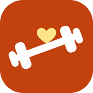

<h1 align="center">Forza!</h1>

<b>Aiuta le persone a cui vuoi bene a diventare più forti e più in salute, un piccolo passo alla volta.</b>

Gratuita · open source · italiano e inglese · funziona su qualsiasi telefono <a href="README.md">🇬🇧 Read in English</a>

---

I nostri genitori stanno invecchiando. Sappiamo che **allenamento di forza, abbastanza proteine, camminare e
dormire bene** li mantengono autonomi e in salute per molti anni in più, ma "vai in palestra e mangia meglio"
non è un consiglio che qualcuno riesce davvero a seguire.

**Forza!** è un'app semplice e amichevole che prepari *per* un genitore o un parente. Lo accompagna in
allenamenti adatti a chi inizia, spiega i progressi in parole semplici, stima i pasti da una foto o da un
codice a barre e insegna le basi con infografiche da stampare. Tu, il "coach" di famiglia, segui i progressi
e aggiorni la scheda dal tuo computer.

  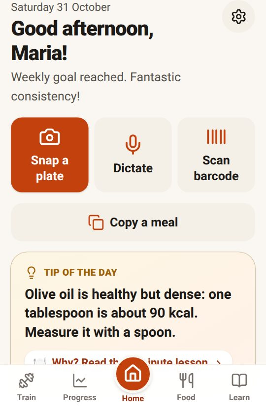
  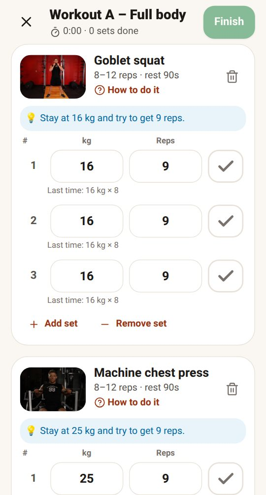
  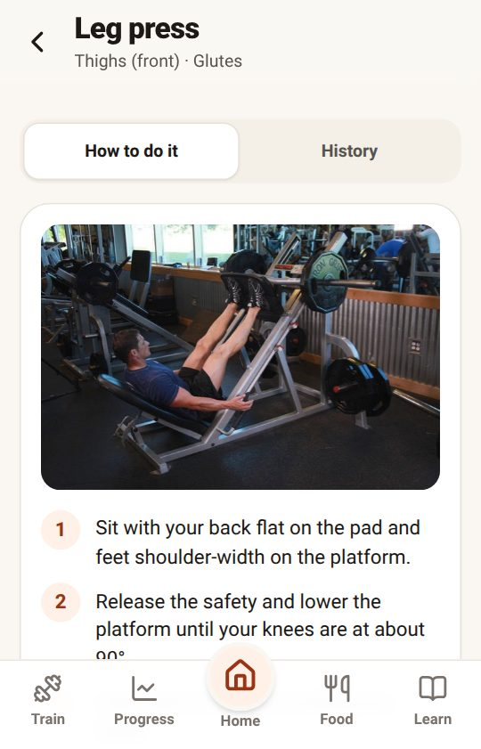
  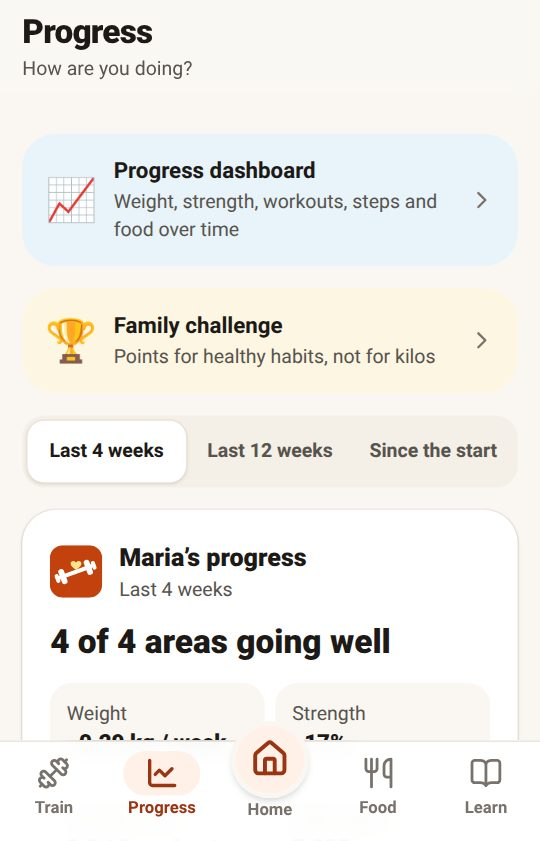

*Schermate della persona di prova, rifatte in automatico dopo ogni modifica all'app. L'app è anche in
italiano: la lingua si cambia in qualsiasi momento.*

## Per chi si allena

| | |
|---|---|
|  | **Un piano chiaro per ogni giorno.** I pulsanti foto, detta e codice a barre in cima, il consiglio del giorno, una breve checklist (allenamento o riposo, pesata, pasti, passi), l'allenamento di oggi, la tendenza del peso e la prossima lezione. Non ti alleni con l'app? Nascondi la sezione Allenati. Ogni parte della pagina si può spostare in su o in giù, da sé o dal proprio coach. |
|  | **Allenamenti per principianti.** Ogni esercizio ha foto, tre passi semplici e un video. I pesi sono **già compilati e salgono da soli** quando si diventa più forti. Serie di riscaldamento, superset, timer di recupero con suono e "quanto è stata dura?" per ogni serie. Funziona anche senza campo in palestra. Le idee principali rimandano agli studi che le sostengono. |
|  | **Progressi che tutti capiscono.** Tendenza del peso (smussata, così gli alti e bassi di ogni giorno non scoraggiano), forza guadagnata, costanza, passi, ognuno con un giudizio in parole e un consiglio concreto. Settimane di fila, record, foto dei progressi private e una scheda "condividi con la famiglia". |
| 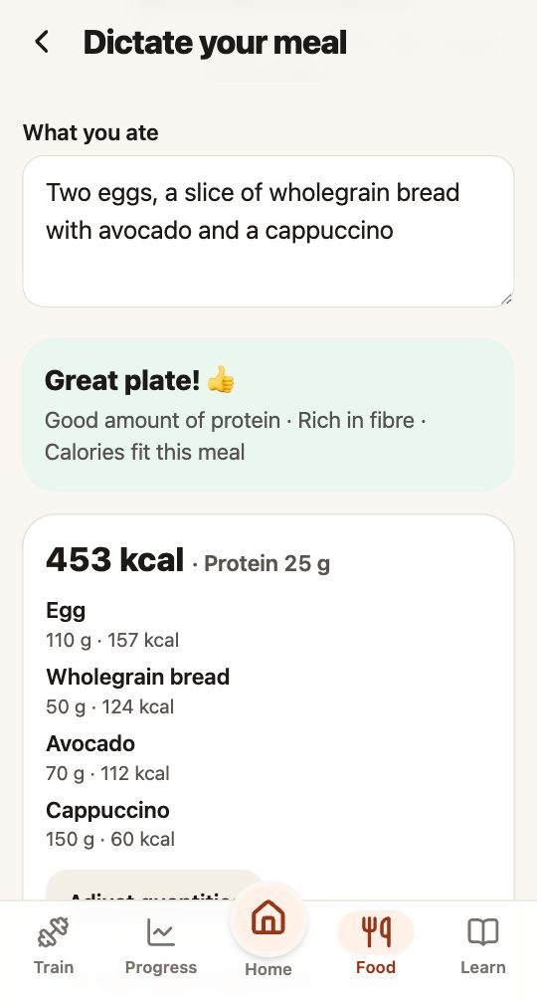 | **Oppure basta dirlo.** Tocca **Detta** e di' cosa hai mangiato («due uova, una fetta di pane e un caffè»): il riconoscimento vocale del telefono lo scrive, Forza! riconosce cibi e quantità sul telefono e chiede all'AI solo quelli che non conosce. Puoi correggere le parole, e i grammi solo se vuoi. |
| 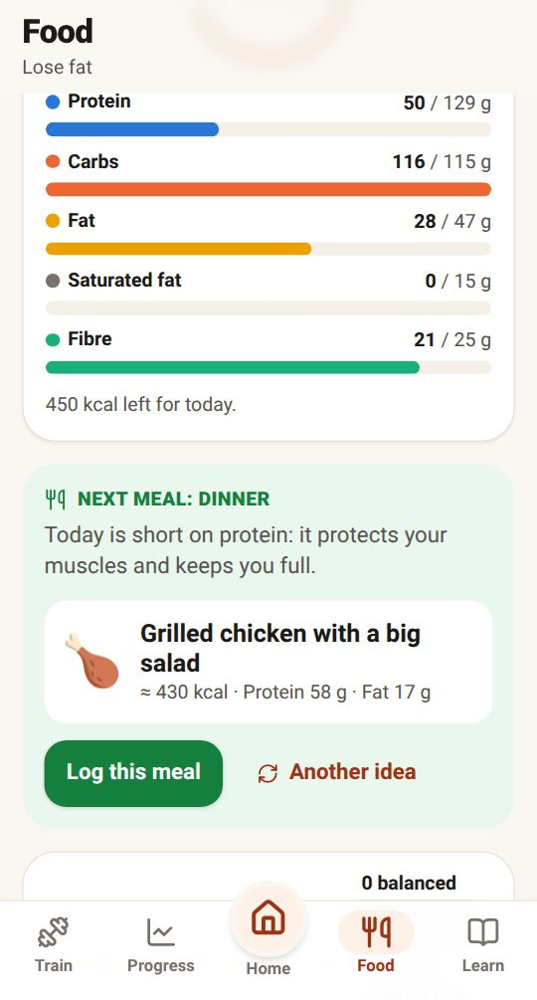 | **Cosa mangiare dopo.** Dopo ogni pasto, un'idea per il successivo che porta quello che manca alla giornata (pollo e patate a pranzo? A cena grassi buoni), già dosata sulle calorie rimaste e registrabile con un tocco. |
| 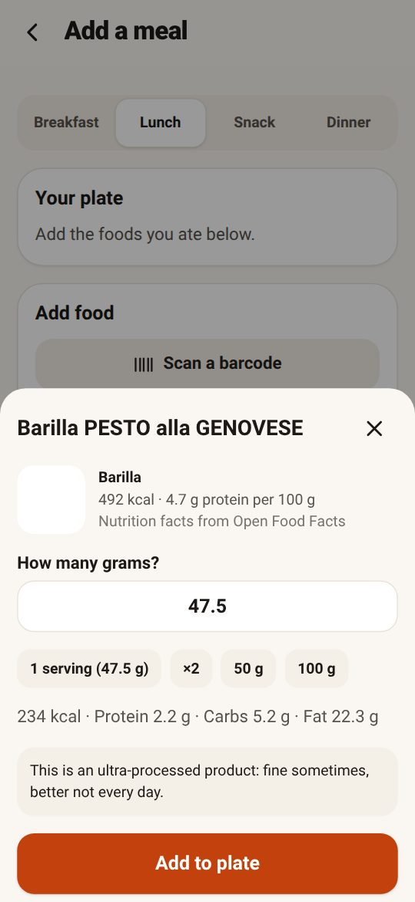 | **Il cibo in tre modi.** Una foto del piatto (l'AI stima ogni alimento), il **codice a barre** (Open Food Facts, milioni di prodotti) o a mano. Dopo una foto, Forza! dice prima **cosa fare** ("Aggiungi proteine!"), poi mostra i numeri; con un tocco rifai la foto o correggi a mano. Ogni piatto riceve un punteggio per perdere grasso e per aumentare i muscoli. |
| 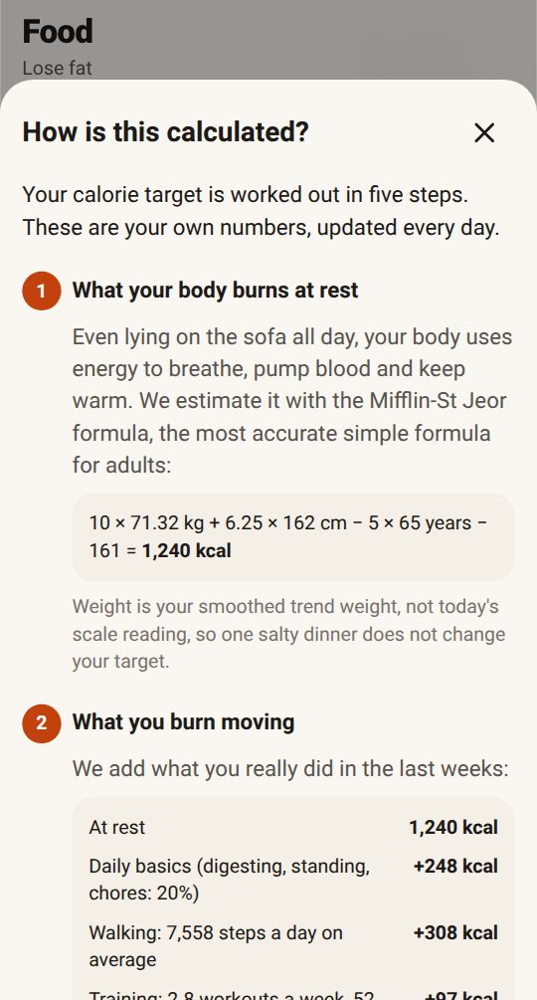 | **Un obiettivo di calorie che si spiega da solo.** Cinque passaggi con i propri numeri: energia a riposo, camminata e allenamento (dai passi del telefono), la verifica con la bilancia, l'obiettivo e come si dividono le calorie tra proteine, grassi e carboidrati. |
| 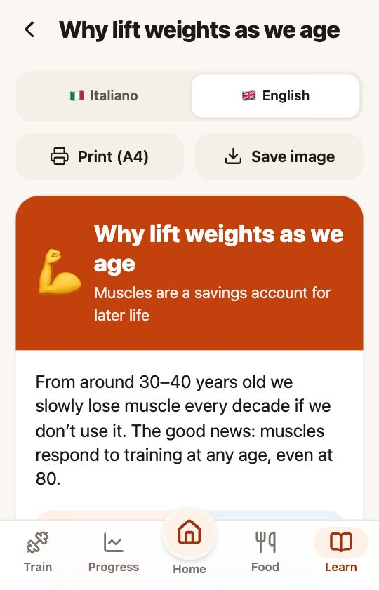 | **Impara le basi, poi di più.** Un corso base di 14 brevi infografiche (proteine, piatto equilibrato, trucchi per avere energia costante, sonno, …) e lezioni per esperti (glicogeno, distribuzione dei pasti, creatina, …), ognuna con un quiz di due domande, punti e medaglie. Si stampano su fogli A4, in italiano o inglese. |

Passi e peso arrivano da soli da **Connessione Salute** (Android, ogni ora) o **Apple Salute** (iPhone), quindi
le bilance smart come **Eufy** funzionano subito. Arrivi da **Build With Science**? Lo storico degli
allenamenti viene con te e **resta sincronizzato**: i pasti tramite Connessione Salute, i nuovi allenamenti
letti dal telefono stesso (o da Forza! Coach). Una **sfida di famiglia** amichevole e facoltativa dà punti per l'impegno (allenamenti,
lezioni, passi, pasti registrati), mai per il peso: anche chi comincia può superare chi si allena da anni.

## Per te, il coach di famiglia

| | |
|---|---|
| 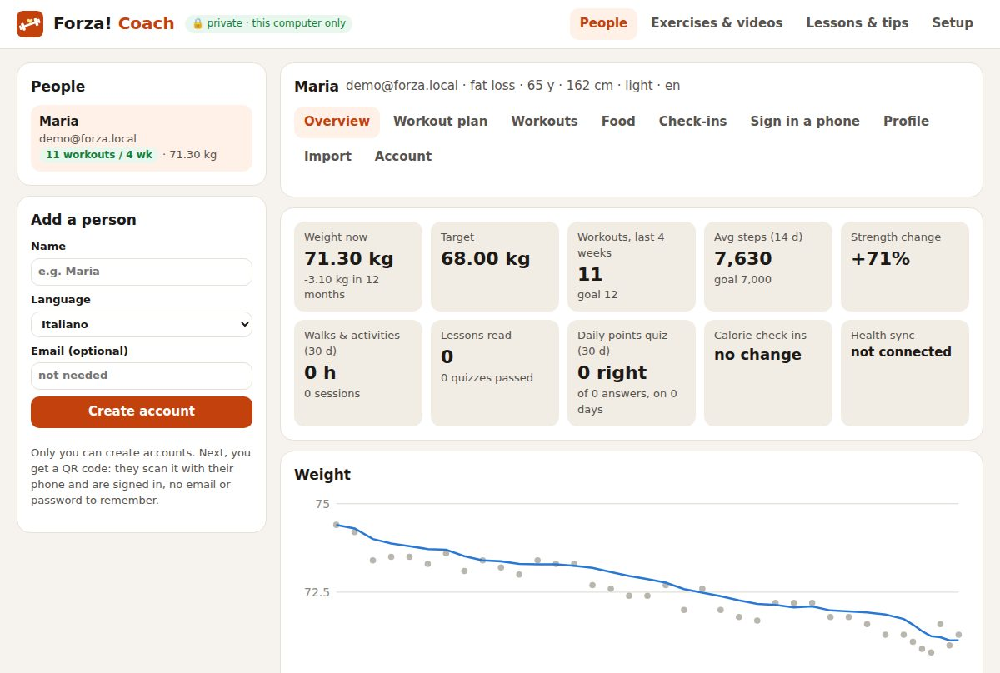 | **Forza! Coach** funziona sul tuo computer (Mac, Windows o Linux). Configura tutto per te, crea gli account e mostra di ognuno peso, forza, allenamenti, pasti e check-in. Modifichi la scheda da casa: compare sul telefono alla prossima apertura. Aggiungi chiavi AI di più servizi (Gemini, OpenRouter, …) e scegli in che ordine le foto del cibo le provano. |
| 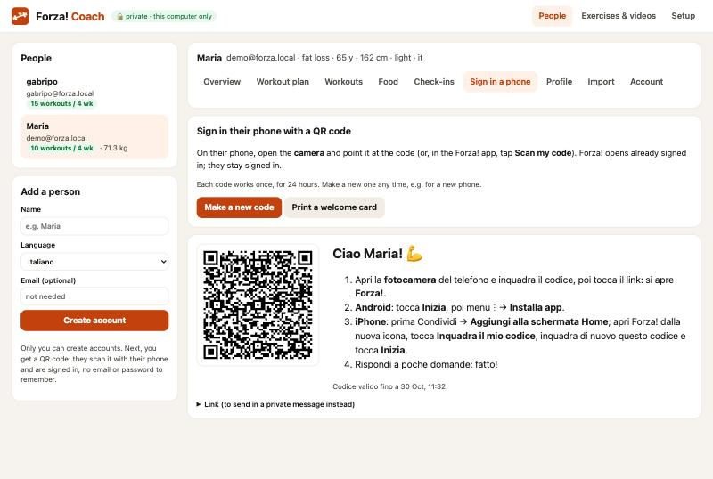 | **Nessuna password da ricordare.** Crei un codice QR, la persona lo inquadra con la fotocamera e Forza! si apre già con l'accesso fatto. Puoi stamparlo su un biglietto di benvenuto con le istruzioni. |
| 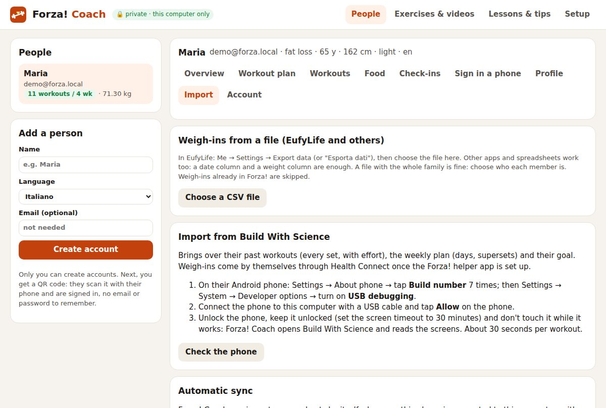 | **Porta con te lo storico e tienilo aggiornato.** Collega il telefono Android (cavo o Wi-Fi) e Coach importa da Build With Science ogni allenamento con serie e sforzo, la scheda settimanale e l'obiettivo. Con la sincronizzazione automatica i nuovi allenamenti arrivano da soli. |

## Come iniziare

Servono un computer e circa 30 minuti. Nessuna competenza tecnica, nessun costo.

1. **Installa [Node.js](https://nodejs.org/it/download)** (versione LTS) e **scarica Forza!**
   (pulsante verde **Code** qui sopra → **Download ZIP**, poi decomprimi).
2. **Doppio clic su "Forza Coach"** nella cartella (`Forza Coach (Mac).command`, `Forza Coach (Windows).bat`
   oppure `forza-coach-linux.sh`). Segui i quattro passi sullo schermo: un account Supabase gratuito, il tuo
   database, una chiave gratuita (facoltativa) per le foto del cibo, installazione.
3. **Aggiungi una persona** e falle **inquadrare il codice QR** con il telefono. Fatto.

👉 La **[guida per il coach](docs/coach-guide.it.md)** spiega ogni passo, anche la sincronizzazione con
Salute, le bilance smart e l'importazione da Build With Science.

## Privata e gratuita

- Ogni famiglia ha **il proprio database** (un progetto Supabase gratuito che appartiene a te). Ognuno vede
  solo i propri dati. Solo il coach può creare account.
- La chiave principale resta **sul computer del coach**, nel suo archivio password (Portachiavi, Gestione
  credenziali o il portachiavi di Linux).
- Tutto funziona con piani gratuiti: Supabase, GitHub Pages, Google Gemini (foto del cibo), Open Food Facts.

## Documentazione

| | |
|---|---|
| [Guida per il coach](docs/coach-guide.it.md) | Configurazione passo per passo (anche in [inglese](docs/coach-guide.md)) |
| [Come è progettata Forza!](docs/design.md) | Funzioni, formule, architettura, sicurezza e i motivi delle scelte (in inglese) |
| [Configurazione avanzata](docs/advanced-setup.md) | Riga di comando su macOS/Windows/Linux, Supabase CLI, una tua copia dell'app, sviluppo (in inglese) |
| [AI per le foto del cibo](docs/food-ai.md) | Prove con cibi noti e alternative gratuite a Gemini (in inglese) |

## Contribuire

Idee, traduzioni (altre lingue sono benvenute!), contenuti sugli esercizi e segnalazioni di bug sono molto
graditi: apri una issue o una pull request. I contenuti sulla salute vogliono essere semplici **e** corretti:
se trovi qualcosa di impreciso, faccelo sapere.

## Avvertenza

Forza! offre informazioni generali e **non sostituisce il parere medico**. Chi inizia un programma di
allenamento, soprattutto se anziano o con problemi di salute, deve prima parlarne con il proprio medico.

## Licenza

[MIT](LICENSE)
