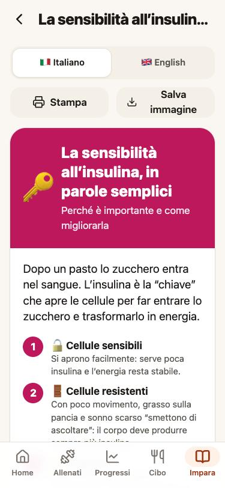

<p align="center"></p>

<h1 align="center">Forza!</h1>
<p align="center"><b>Help the people you love get stronger and healthier, one small step at a time.</b></p>
<p align="center">Free · open source · English &amp; Italian · works on any phone<br><a href="README.it.md">🇮🇹 Leggi in italiano</a></p>

---

Our parents are getting older. We know that **strength training, enough protein, walking and good sleep**
can keep them independent and healthy for many more years, but "go to the gym and eat better" is not
advice anyone can follow.

**Forza!** is a simple, friendly app that you set up *for* a parent or relative. It guides them through
beginner-friendly workouts, shows their progress in plain language, estimates their meals from a photo, and
explains the basics of health with printable infographics. You, the family "coach", follow along and adjust
their plan from a private dashboard on your computer.

<p align="center">
  
  
  
  
  
</p>

## What it does

**🏠 Dashboard.** Weight trend (a smoothed line, so daily ups and downs don't discourage anyone),
strength gains per exercise, workouts this week, steps, today's food, and a daily tip.

**🏋️ Training mode, made for beginners.**
- Every exercise has start/end photos, three plain steps, a key tip and a video link.
- Weights are **pre-filled and progression is automatic**: *"Last time you did all your reps: try 18 kg today."*
- One tap per set, an "how hard was it?" scale (Easy · Good · Hard · Max), and a **rest timer** with sound and vibration.
- The screen stays on, and workouts are saved on the phone first, so a weak gym signal never loses a set.
- **Supersets** (alternate two exercises, one rest), automatic **warm-up sets** for big lifts, and a
  **weekday schedule** (e.g. Thursday A, Saturday B) with this week's plan, done workouts and synced walks.
- Every exercise has a **history** of past sets and personal records (heaviest lift, best set).
- Create your own workouts, or let the family coach prepare the plan remotely.

**✅ Daily checklist.** Today's workout (or rest day), weigh-in, meals and steps, with "3 of 4 done".

**📈 Progress check.** Weight speed vs. goal, strength change, consistency, steps and nutrition, each as a
clear verdict (*Good / OK / Needs attention*) with one concrete suggestion. Weekly check-ins for energy,
sleep, mood and waist. Week **streak**, all-time workouts, recent **personal records**, private **progress photos**
(first vs latest), and a **"Share with family"** progress card.

**📸 Calories from a photo.** Snap the plate; Google Gemini estimates every item and its macros. The portions
can be corrected, and the plate is **scored for fat loss and for muscle gain** against the person's own energy
needs (TDEE). The TDEE starts from profile and activity level, then adapts to logged steps, workouts and, after
two weeks of food logging, to what the scale actually did. A **weekly check-in** compares the weight trend with
the goal pace and suggests a small calorie change (±100–150 kcal). Manual entry with 60+ common foods is always available.

**📚 Learn.** A short **guided course** (with a "Next lesson" card on Home) of twelve beginner infographics,
printable on A4 or saved as images, in Italian or English:
why strength matters with age · macronutrients · the balanced plate (and hand portions) · protein ·
where to find each nutrient · fibre · insulin sensitivity · what to eat before/after training · meal ideas ·
more movement with little effort · sleep · 10 small habits.

**🔄 Automatic steps and weight.** iPhone via an Apple Shortcut, Android via a tiny Health Connect helper app.
Walks and other workouts show up as activities. A **Eufy** (or any) smart scale works through Apple Health /
Health Connect, and old weigh-ins can be imported from CSV.

**🔒 Private by design.**
- Accounts are created **only by you** (public sign-up is closed).
- Each person sees only their own data (Postgres row-level security).
- The admin dashboard runs **only on your Mac**, with the master key stored in the macOS Keychain.

## How it fits together

```
 Phones (installable web app)                 Your Mac
 ┌──────────────────────────┐                ┌────────────────────────────┐
 │ Forza! PWA (GitHub Pages)│                │ Admin dashboard (localhost)│
 │  React · offline-first   │                │  key in macOS Keychain     │
 └───────────┬──────────────┘                └─────────────┬──────────────┘
             │  user login (RLS)                           │ service key
             ▼                                             ▼
 ┌─────────────────────────────────────────────────────────────────────────┐
 │ Supabase: Postgres · Auth · Storage · Edge Functions                     │
 │   food-estimate → Google Gemini        health-ingest ← Shortcut / APK    │
 └─────────────────────────────────────────────────────────────────────────┘
```

| Folder | What |
|---|---|
| [`app/`](app) | The phone app: React + TypeScript + Vite + Tailwind, installable PWA |
| [`admin/`](admin) | Private admin dashboard (Node, no build step) |
| [`supabase/`](supabase) | Database schema with row-level security, server functions, local demo data |
| [`android-helper/`](android-helper) | Kotlin Health Connect sync app |
| [`docs/`](docs) | [Setup guide](docs/setup.md) · [iPhone Shortcut](docs/apple-shortcut.md) |

## Get started

Follow **[docs/setup.md](docs/setup.md)**: fork, create a free Supabase project, run one deploy script, set two
GitHub variables, and you're live. Total cost: €0 for a family.

Try it locally with demo data in two minutes:

```bash
supabase start && supabase db reset   # demo user "Maria", 10 weeks of history
cd app && npm install && npm run dev  # http://localhost:5173 · demo@forza.local / forza-demo-2026
```

## Contributing

Ideas, translations (more languages are welcome!), exercise content and bug reports are very welcome.
Open an issue or a pull request. The health content aims to be simple **and** correct: if you spot something
inaccurate, please tell us.

## Credits

- Exercise photos: [free-exercise-db](https://github.com/yuhonas/free-exercise-db) (public domain).
- Icons: [Lucide](https://lucide.dev) (ISC).

## Disclaimer

Forza! offers general information and is **not medical advice**. Anyone starting an exercise program,
especially older adults or people with health conditions, should check with their doctor first.

## License

[MIT](LICENSE)
