
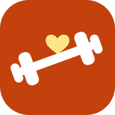

<h1 align="center">Forza!</h1>

<b>Help the people you love get stronger and healthier, one small step at a time.</b>

Free · open source · English and Italian · works on any phone <a href="README.it.md">🇮🇹 Leggi in italiano</a>

---

Our parents are getting older. We know that **strength training, enough protein, walking and good sleep**
keep them independent and healthy for many more years, but "go to the gym and eat better" is not advice
anyone can follow.

**Forza!** is a simple, friendly app that you set up *for* a parent or a relative. It guides them through
beginner-friendly workouts, explains their progress in plain words, estimates meals from a photo or a
barcode, and teaches the basics with printable infographics. You, the family "coach", follow their progress
and adjust their plan from your own computer.

  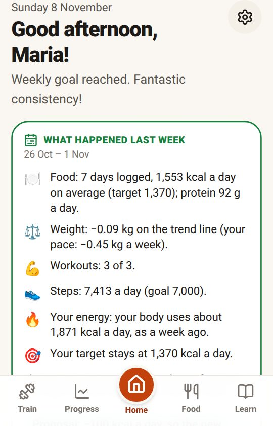
  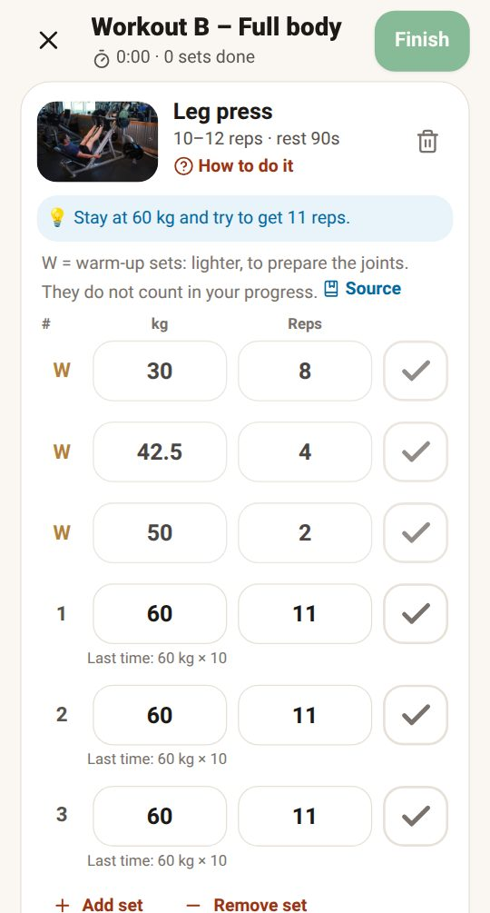
  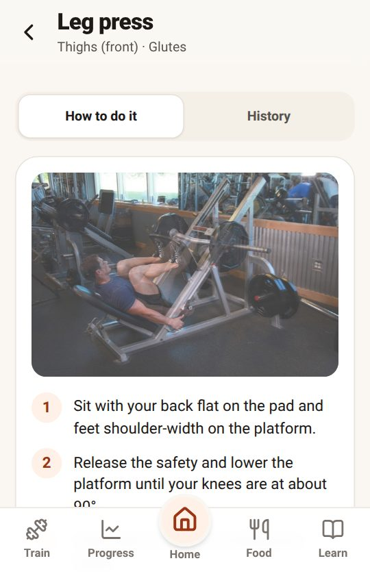
  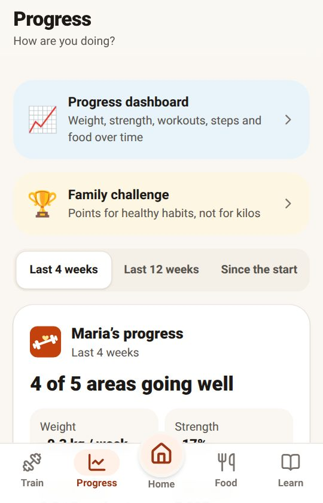

*Screenshots of the demo family member, retaken automatically after every change to the app.*

## Killer features

  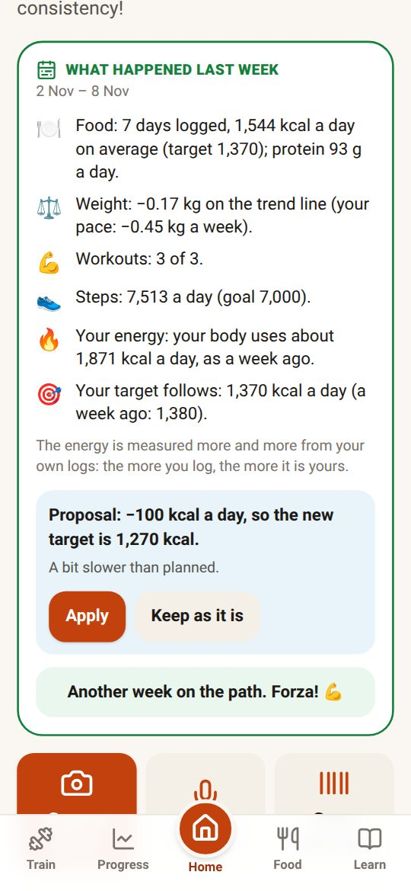
  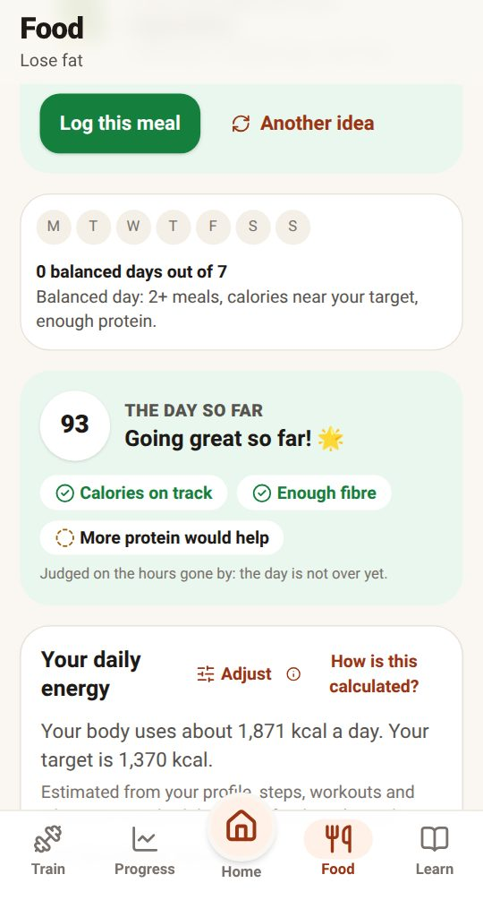
  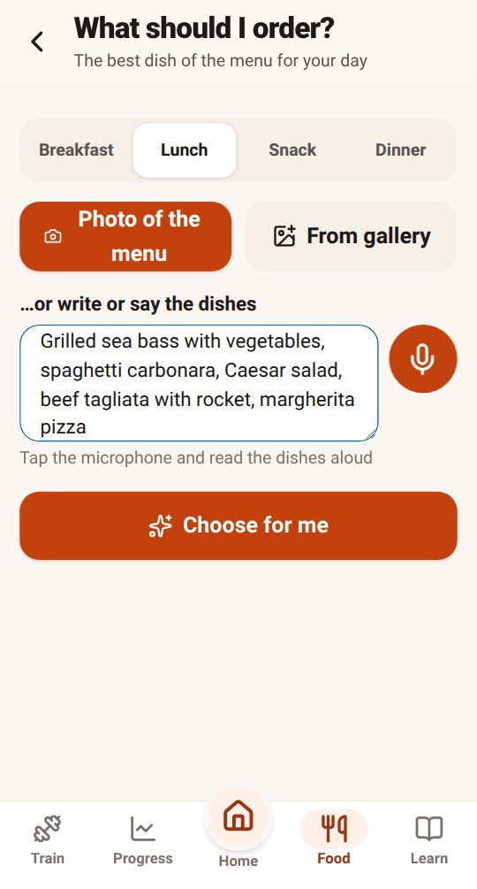
  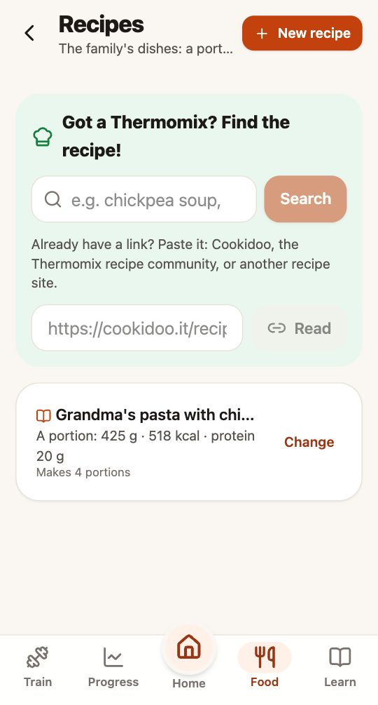
  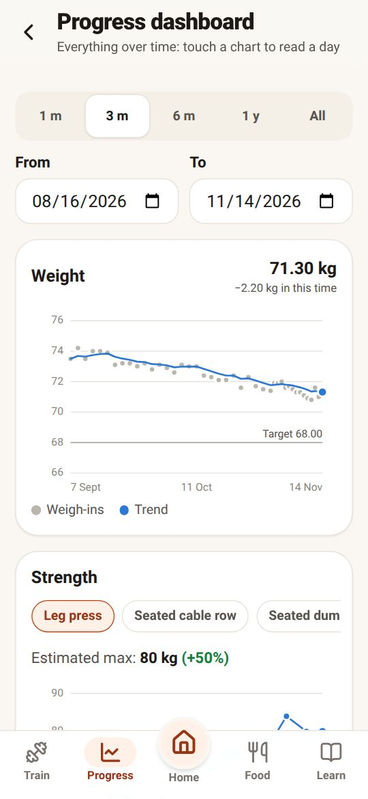
  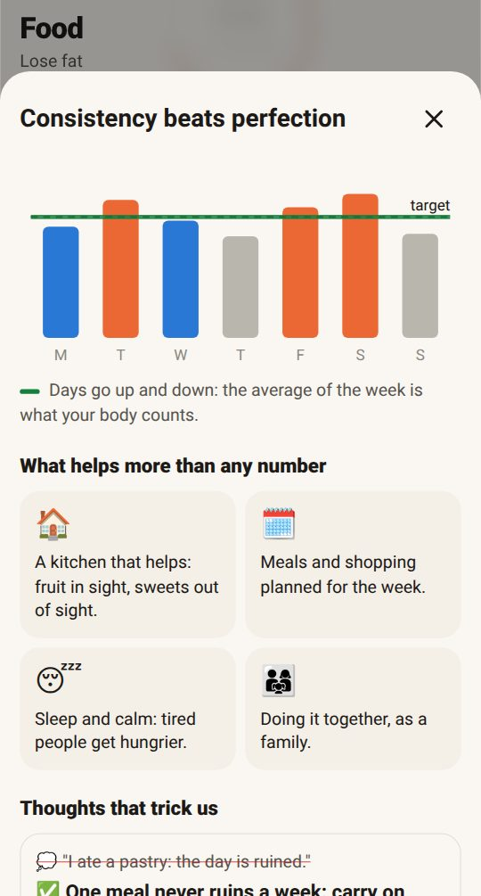

- 🍽️ **"What should I order?"** Photograph a restaurant menu, or say the dishes: a quick AI reads it, a stronger
  one picks the best dish for *your* day so far and says why in everyday words, with one small tweak to ask for.
- 📷 **Snap, say or scan a meal**, and see first what to do ("add some protein"), judged together with the rest
  of that meal and of the day. A meal that looks logged by mistake ("Taralli" saved as 3 g of breadsticks) is
  asked about until it is corrected or confirmed, and any meal can be changed later: foods and amounts. A scanned
  product that is wrong is put right with "Not this one?", for the whole family's next scans.
- 🧑‍🍳 **No idea what to eat? Build your own recipe.** Type, say, scan or photograph what you have at home: up to
  three recipes for your next meal, with amounts that fit what is left of your day.
- 🍦 **Fewer processed foods, kindly.** Whoever often logs ice cream, biscuits or snacks is asked whether they know
  these fill you up less and bring fewer nutrients, with many alternatives just as pleasant, one tap away.
- 📖 **Family recipes, Thermomix included.** Write a dish once (type the ingredients, scan their barcodes or
  photograph them, or the recipe written down, or type their values; or make it from a meal you logged, Build With Science's too), with
  its method step by step (baking brings its temperature, oven mode and time), then anyone logs a portion in one tap. Got a
  Thermomix (Bimby)? Find the recipe in the app or paste a Cookidoo link: the ingredients are read for you, and a
  variant of your own (less butter, another vegetable) is one tap away.
- 👨‍👩‍👧 **Cook once, log for everyone.** Share a meal with whoever ate it, each with their own percentage of it; the family's
  food database grows with every meal anyone logs. A family coach, chosen in Forza! Coach, can log meals for the
  others too, straight into their food log, and sees the whole family's day on their phone: targets and meals.
- 🧭 **The day and the week at a glance.** A kind score for the whole day, a ring of what each meal brings to the
  day's target (calories, protein, carbs or fat), each meal's breakdown, one sentence of encouragement on Home, and
  every week "What happened last week". After days short of protein (or of calories, when not losing fat), a few
  foods that bring it back, one tap away.
- 🔥 **A target that learns from you.** The energy your body uses is measured more and more from your own food
  and scale, fully after about 4 weeks of logs and weigh-ins (two lessons explain why, and why two people of
  the same weight can need 750 kcal apart); days not all logged are left out (you are asked, and can change it later), intermittent fasting
  is recognised, the formulas are shown and the history is kept.
- 💪 **Workouts that progress by themselves**, and any exercise found from a description ("I raise a knee and
  touch it with the opposite elbow"), with its photos.
- 📈 **Progress for any period**, every chart read with a touch, and the targets over time told as a path.
- 🧘 **Serene, not obsessed.** "Why one day's numbers matter little": consistency and a helpful home beat
  perfect days.

## For the person training

| | |
|---|---|
|  | **A clear plan for every day.** Photo, dictate and barcode buttons right at the top, the tip of the day, a short checklist (workout or rest, weigh-in, meals, steps), today's workout, the weight trend and the next lesson. Not training in the app? Hide the Train section. Every part of the page can be moved up or down, by them or by their coach. |
|  | **Workouts for beginners.** Every exercise has photos, three simple steps and a video. Weights are **pre-filled and go up automatically** when they get stronger. Warm-up sets, supersets, a rest timer with sound, and "how hard was it?" for each set. Works without signal in the gym. The main ideas link to the studies behind them. |
|  | **Progress anyone can understand.** Weight trend (smoothed, so daily ups and downs don't discourage), strength gained, consistency, steps, each with a verdict in words and one concrete tip. Streaks, records, private progress photos and a "share with family" card. |
| 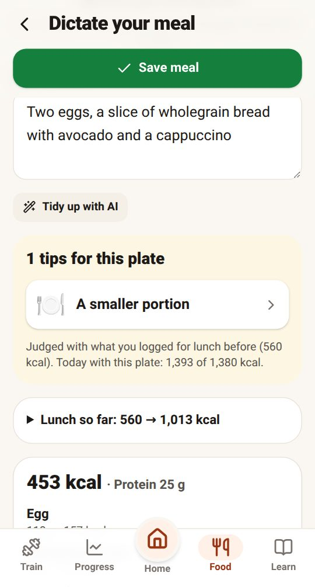 | **Or just say it.** Tap **Dictate** and say what you ate (“two eggs, a slice of bread and a coffee”): the phone's own speech recognition writes it down, Forza! recognises the foods and amounts on the phone, and asks the AI only about the ones it does not know. Fix the words, and the grams only if you want to. |
| 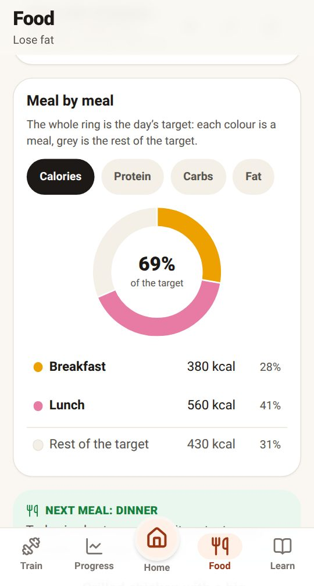 | **Meal by meal.** A ring is the whole day's target: each colour is a meal, grey is what is left. Switch between calories, protein, carbs and fat to see which meal brings what, today or any past day. |
| 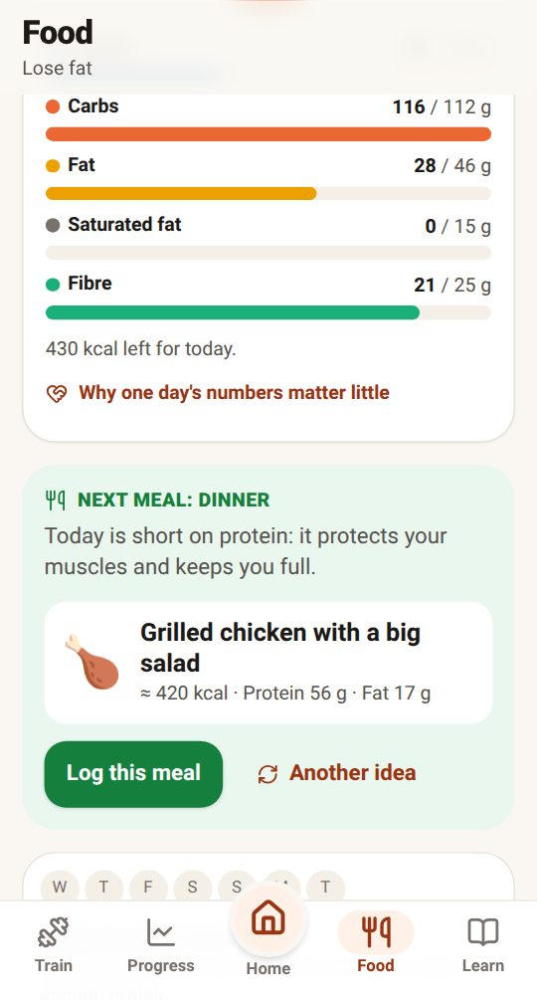 | **What to eat next.** After each meal, an idea for the next one that brings what the day is missing (chicken and potatoes for lunch? Dinner with healthy fats), already sized to the calories left and one tap away from logging. |
| 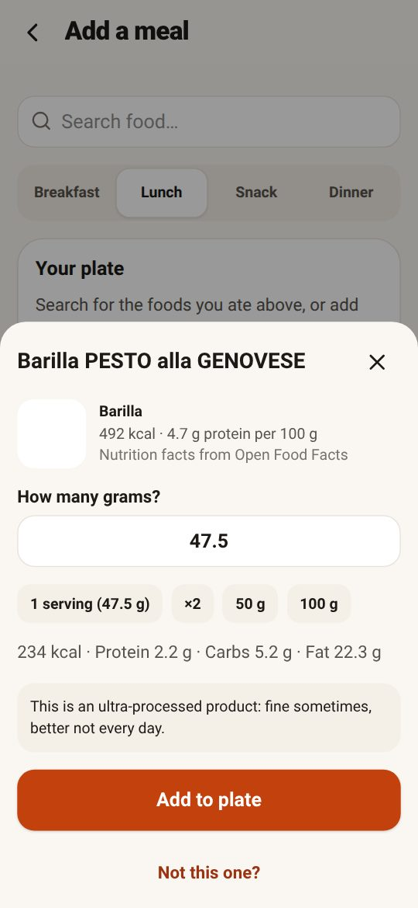 | **Food in three ways.** Snap a photo of the plate (AI estimates every item), **scan a barcode** (Open Food Facts, millions of products), or add it by hand. After a photo, Forza! first says **what to do** ("Add some protein!"), then shows the numbers; one tap retakes the photo or fixes it by hand. Forgot a meal? It goes into any of the last four weeks, with the day and the meal chosen at the top. Every plate gets a score for losing fat and for building muscle. |
| 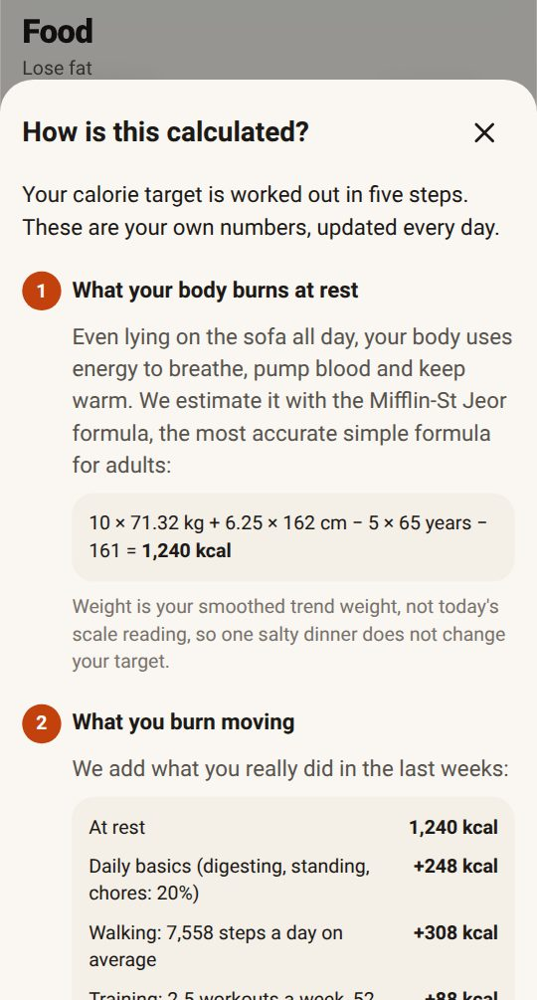 | **A calorie target that explains itself.** Five steps with their own numbers: energy at rest, walking and training (from the phone's steps), a reality check with the scale, the goal, and how calories split into protein, fat and carbs. |
| 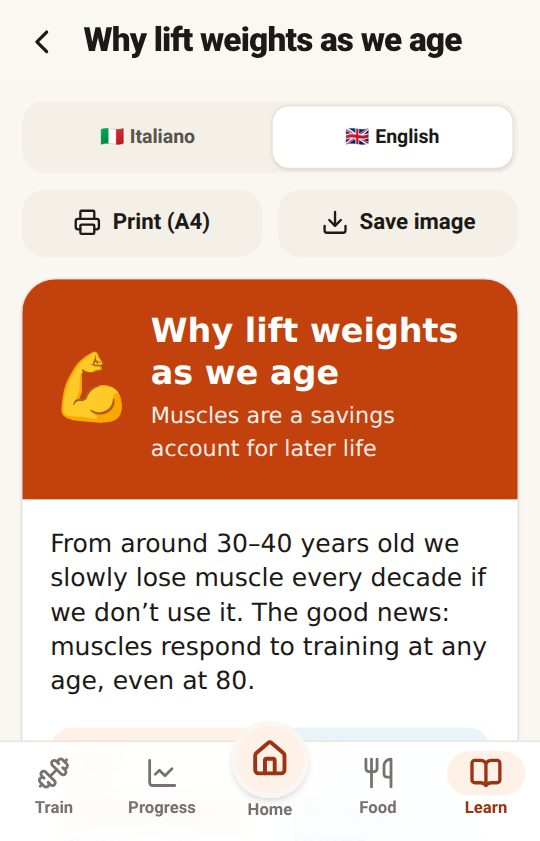 | **Learn the basics, then more.** A beginners' course of 14 short infographics (protein, balanced plates, meal tricks for steady energy, sleep, …) and expert lessons (glycogen, meal timing, creatine, …), each with a two-question quiz, points and badges. Print them on A4 paper, in English or Italian. |

Steps and weight arrive by themselves from **Health Connect** (Android, every hour) or **Apple Health** (iPhone),
so smart scales like **Eufy** just work. Coming from **Build With Science**? The whole workout history comes
along, and it **stays in sync**: meals through Health Connect, new workouts read by the phone itself (or by Forza! Coach).
A friendly, opt-in **family challenge** gives points for showing up (workouts, lessons, steps, meals logged),
never for weight, so a beginner can beat the family athlete.

## For you, the family coach

| | |
|---|---|
| 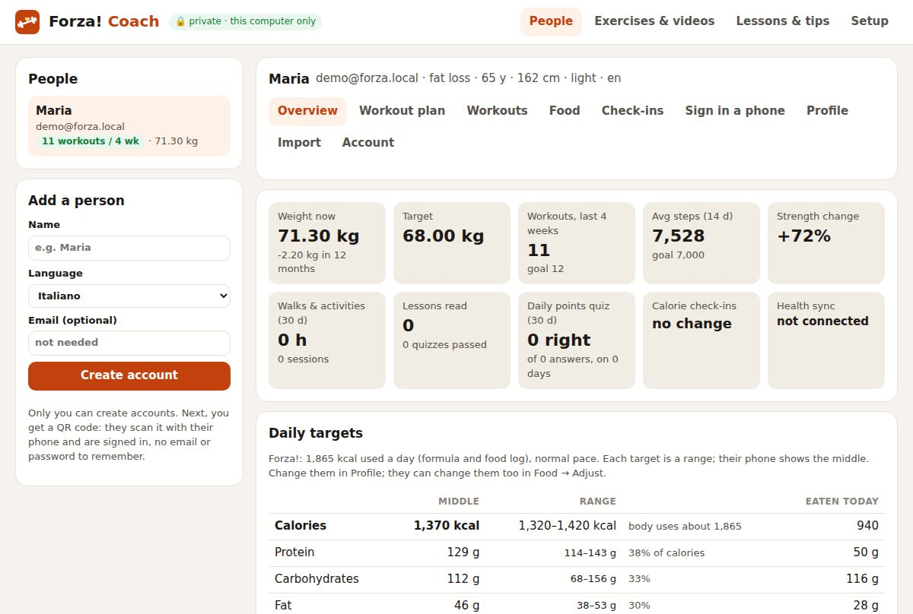 | **Forza! Coach** runs on your computer (Mac, Windows or Linux). It sets everything up for you, creates the accounts, and shows each person's weight, strength, workouts, meals and check-ins. Edit their workout plan from home: it appears on their phone at the next opening. Add AI keys from several services (Gemini, OpenRouter, …) and choose the order in which food photos try them. |
| 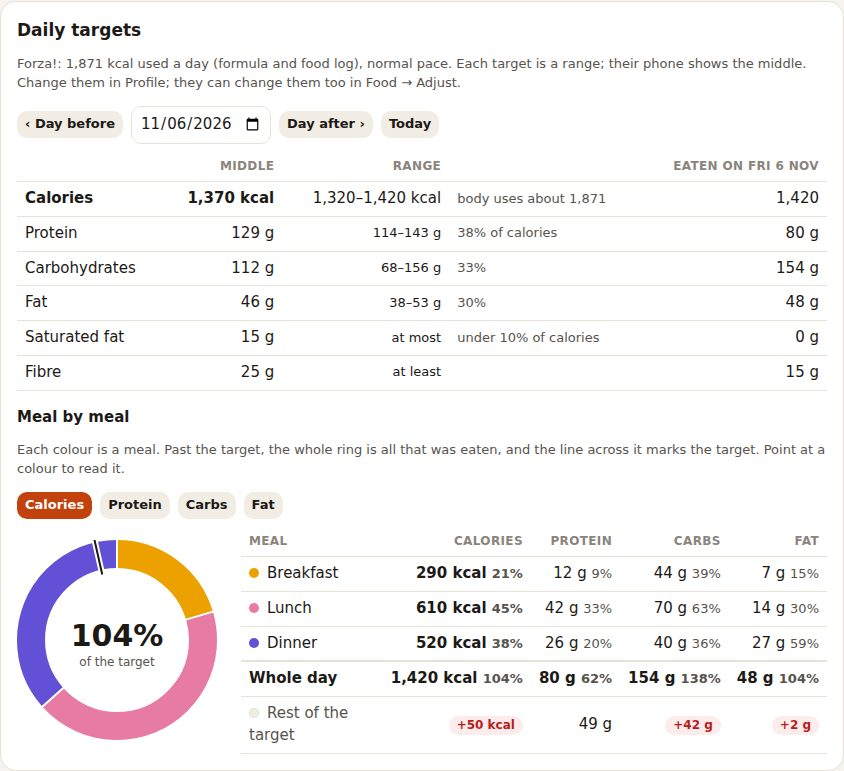 | **Any day, meal by meal.** Pick a day (or step back one at a time) to see what they ate against their targets, with the same ring as their phone and every meal's calories, protein, carbs and fat. |
| 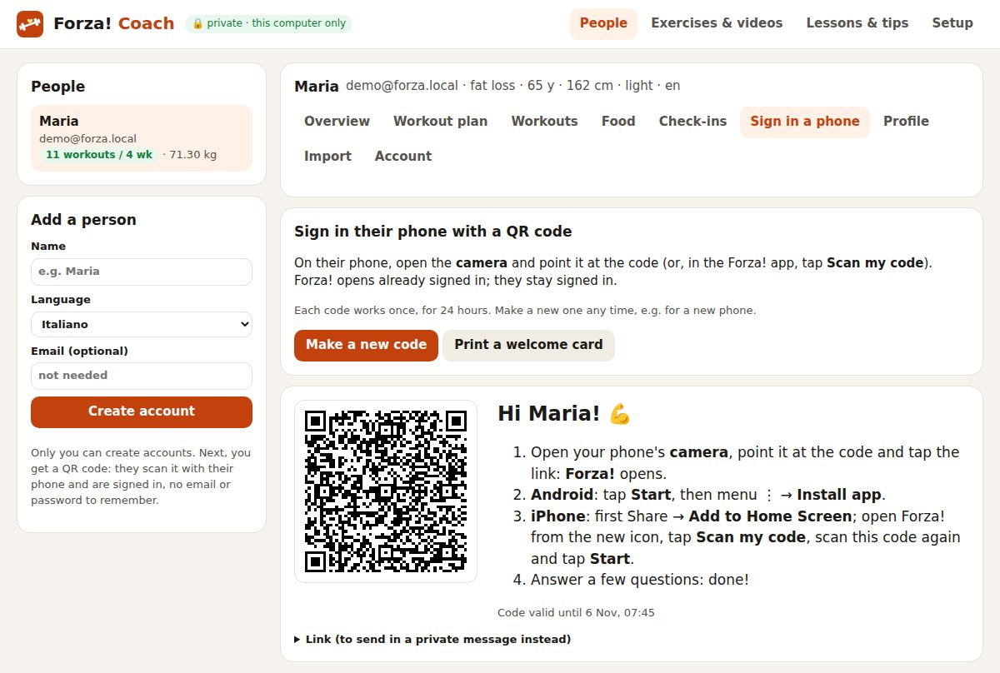 | **No passwords for them.** Make a QR code, they point the phone camera at it, and Forza! opens already signed in. Print it on a welcome card with simple instructions. |
| 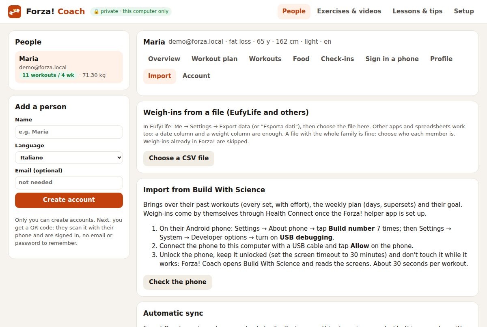 | **Bring their history, and keep it in sync.** Connect their Android phone (cable or Wi-Fi) and Coach imports every workout, set and effort, the weekly plan and the goal from Build With Science. Turn on automatic sync and new workouts follow by themselves. |

## Get started

You need a computer and about 30 minutes. No technical skills, no cost.

1. **Install [Node.js](https://nodejs.org/en/download)** (the LTS version) and **download Forza!**
   (green **Code** button above → **Download ZIP**, then unzip it).
2. **Double-click "Forza Coach"** in the folder (`Forza Coach (Mac).command`, `Forza Coach (Windows).bat`,
   or `forza-coach-linux.sh`). Follow the four steps on screen: a free Supabase account, your database, an
   optional free key for food photos, install.
3. **Add a person** and let them **scan the QR code** with their phone. Done.

👉 The **[Coach guide](docs/coach-guide.md)** ([italiano](docs/coach-guide.it.md)) walks you through every
step, including health sync, smart scales and the Build With Science import.

## Private and free

- Each family has **its own database** (a free Supabase project that belongs to you). Each person sees only
  their own data. Only the coach can create accounts.
- The master key stays **on the coach's computer**, in its password store (Keychain, Credential Manager or
  the Linux keyring).
- Everything runs on free plans: Supabase, GitHub Pages, Google Gemini (food photos), Open Food Facts.

## Documentation

| | |
|---|---|
| [Coach guide](docs/coach-guide.md) | Step-by-step set-up for the family coach (also in [Italian](docs/coach-guide.it.md)) |
| [How Forza! is designed](docs/design.md) | Features, formulas, architecture, security and the reasons behind them |
| [Advanced set-up](docs/advanced-setup.md) | Command line on macOS/Windows/Linux, Supabase CLI, your own copy of the app, local development |
| [Food photo AI](docs/food-ai.md) | Test results with well-known foods, and free alternatives to Gemini |
| [Apple Shortcut](docs/apple-shortcut.md) · [Import format](docs/import-format.md) | iPhone health sync · importing history from other apps |

## Contributing

Ideas, translations (more languages are welcome!), exercise content and bug reports are very welcome: open
an issue or a pull request. Health content aims to be simple **and** correct: if something looks inaccurate,
please tell us.

## Disclaimer

Forza! gives general information and **does not replace medical advice**. Anyone starting an exercise
programme, especially older people or people with health conditions, should talk to their doctor first.

## License

[MIT](LICENSE)
