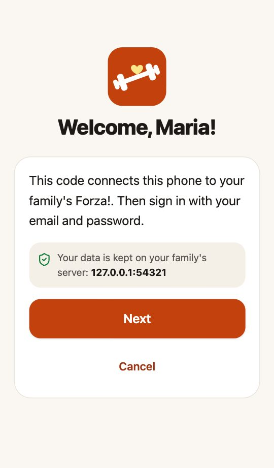

# Coach guide: set up Forza! for someone you love

*🇮🇹 [Leggi in italiano](coach-guide.it.md)*

This guide is for you if you are setting Forza! up for a parent, a grandparent or another relative.
We call you the **coach**: you prepare everything on your computer, they just use the app on their phone.

You need no technical knowledge. Plan **about 30 minutes** the first time, with their phone next to you.

**What you need**

- A computer: Mac, Windows or Linux.
- Their phone: Android or iPhone, with internet.
- An email address for you (to create two free accounts: Supabase and, optionally, Google).

**What it costs**: nothing. Every piece runs on free plans that are more than enough for a family.

---

## 1. Get Forza! Coach on your computer

Forza! Coach is a small app that runs **only on your computer**. It creates the accounts, shows
everyone's progress and lets you change their workout plan from home.

1. **Install Node.js** (free, needed by Forza! Coach): open [nodejs.org](https://nodejs.org/en/download),
   download the **LTS** version for your computer and install it like any other program.
2. **Download Forza!**: on the [Forza! page on GitHub](https://github.com/gabripo/forza), click the green
   **Code** button → **Download ZIP**. Unzip it (double-click the file) and move the `forza` folder
   somewhere you will find it again, like *Documents*.
3. **Start Forza! Coach** from the `forza` folder:

   | Computer | Do this |
   |---|---|
   | **Mac** | Double-click **Forza Coach (Mac).command**. The first time macOS may say it cannot verify the developer: right-click the file → **Open** → **Open**. |
   | **Windows** | Double-click **Forza Coach (Windows).bat**. If Windows shows "Windows protected your PC", click **More info** → **Run anyway**. |
   | **Linux** | Run `./forza-coach-linux.sh` in a terminal (or right-click → *Run as a program*). |

   A window with some text opens (keep it open while you use Coach) and, after a few seconds,
   Forza! Coach appears in your web browser. The first start takes a minute longer.

> To use Coach again later, double-click the same file. Close the text window to stop it.

## 2. First set-up (once)

The first time, Forza! Coach shows a short set-up with four steps.

### Step 1: a free Supabase account

[Supabase](https://supabase.com) keeps Forza!'s data online (it is a database company; the free plan is
enough). The data belongs to you: nobody else, not even the authors of Forza!, can see it.

1. Open [supabase.com/dashboard/sign-up](https://supabase.com/dashboard/sign-up) and create an account.
2. Open [Account → Access Tokens](https://supabase.com/dashboard/account/tokens) → **Generate new token**,
   call it "Forza Coach", and copy it.
3. Paste it in Forza! Coach and click **Save token**.

### Step 2: where Forza! lives

Click **Create a new free project** (leave the name "forza" and your region) and wait about two minutes.
If you already have a Supabase project you want to use, pick it from the list instead.

### Step 3: food photos (optional)

Forza! can estimate the calories of a meal from a photo with Google's Gemini AI. Its free tier is enough
for a family.

1. Open [Google AI Studio → API keys](https://aistudio.google.com/apikey) and sign in with a Google account.
2. Click **Create API key**, copy it and paste it in Forza! Coach.

You can skip this and add it later from **Setup**. Without it, people can still log meals by hand or
scan barcodes.

**More keys, and what happens when one is busy.** Free AI plans have daily limits. In **Setup → Food photo
AI: keys** you can add keys for other services too (OpenRouter has many free models, Groq and Mistral have
free plans, OpenAI is paid); each row has a **Get a key ↗** link and shows whether a key is set. Then, in
**Food photo AI: model use order**, list the models from first choice to last resort: if one is busy, out of
quota or slow (30 seconds), the photo goes to the next one. Models of a service without a key are skipped.
Click **Save order**, choose a test photo and click **Test the whole order**: Coach shows which model
answered, how long it took and which ones were skipped and why. Each row also has its own **Test**.

### Step 4: install

Click **Install Forza!**. In about a minute Coach prepares the database, the server functions and the
sign-in settings. When it says **Forza! is ready**, the set-up is over.

## 3. Add a person and sign in their phone

1. In **People → Add a person**, type their name and language and click **Create account**.
   An email is not needed.
2. Coach opens **Sign in a phone**. Click **Make a sign-in code**: a QR code appears.
3. Give them their phone and ask them to open the **camera** and point it at the code on your screen,
   then tap the link that appears. (Or print a **welcome card** with the code and the instructions.)
   - **Android**: Forza! opens in Chrome. Tap **Start**, then add it to the home screen:
     menu ⋮ → **Install app** (or *Add to Home screen*).
   - **iPhone**: Forza! opens in Safari. Before tapping Start, tap the Share button →
     **Add to Home Screen**. Open Forza! from the new icon, tap **Scan my code**, scan the same QR code
     again and tap **Start**. (On iPhone, the home-screen app keeps its own sign-in, separate from Safari.)
4. They answer a few simple questions (or fill in their **Profile** in Coach beforehand: they then go
   straight to the home screen).

 

Each code works **once**, for **24 hours**. Make a new one whenever needed (a new phone, a reset).
They stay signed in: no password to remember.

## 4. Steps, weight and smart scales

Forza! can read their daily **steps**, **weight** and **meals** from the phone, so they never have to type them.
On their phone, in Forza!: **Settings → Connect Health & scale**, then:

- **Android**: tap **Create sync key**, then **Download** the small *Forza! Health* app and install it
  (allow installing from Chrome when asked). Back in Forza!, tap **Connect the helper** and allow
  *Steps*, *Weight*, *Exercise* and *Nutrition*. It syncs every hour on its own: weigh-ins from the scale,
  steps, walks, and the meals logged in food apps such as Build With Science. Nothing to press, no computer
  needed.
- **iPhone**: follow the link to the **Forza Sync** shortcut ([guide](apple-shortcut.md)) and set it to
  run every day.
- **Eufy (or any smart scale)**: in the EufyLife app, turn on **Health Connect** (Android) or **Apple Health**
  (iPhone) for weight. Forza! picks the weigh-ins up from there.

Once weigh-ins arrive from a scale, the **Log weight** button leaves their Home page (one less thing to do).
To weigh in by hand, the app reminds them of the rule that makes weights comparable: just woken up, after
the toilet, before drinking or eating.

## 5. Coming from Build With Science?

If they used the **Build With Science** app on an **Android** phone, Coach can bring over their history:
every workout with every set and effort, the weekly plan (days and supersets), their goal and step target.
Their weigh-ins and the meals logged in Build With Science come by themselves through Health Connect
(step 4): Build With Science writes every food diary entry there.

1. On their phone, turn on **USB debugging** (once):
   Settings → About phone → tap **Build number** seven times; then Settings → System →
   **Developer options** → **USB debugging** on.
2. Connect the phone to your computer with a USB cable and tap **Allow** on the phone.
3. In Coach, open the person → **Import** → **Check the phone**. The first time, click
   **Download Android tools** (15 MB, from Google).
4. Unlock the phone, set its screen timeout to 30 minutes, and click **Start the import**. Don't touch the
   phone while it works: Coach opens Build With Science and reads its screens like a person would.
   It takes about 30 seconds per workout (an hour for a year of training), and you can stop it any time:
   the next run continues where it stopped.
5. Later, **Only workouts not imported yet** brings over just the new ones.

**Automatic sync of the workouts.** In the same tab, under **Automatic sync**, click **Turn on**: from then on,
whenever that phone is connected to this computer and has been left unlocked and untouched for 3 minutes,
Coach imports the new workouts by itself (every 1–24 hours, as you choose), shows a notice on the phone while
it works and goes back to the home screen. Touching the phone stops it; it tries again later.

**Sync now.** In the same tab, **Sync now** starts an import within a minute, without waiting for the
interval or for the phone to be idle (it still has to be connected and unlocked). They can ask for it from
their phone too: Forza! → **Settings → Connect Health & scale → Sync Build With Science workouts**. The same
page has a **Sync now** button for steps, weight and meals, which does not need your computer at all.

- The phone can stay in another room: use **Wi-Fi debugging** instead of the cable (Developer options →
  **Wireless debugging**, pair it once with this computer; both must be on the same Wi-Fi).
- Coach must be running. In **Setup → Run in the background**, tick **Start Forza! Coach when I log in**:
  it then runs without a window.
- With "keep the plan in sync", Build With Science is the source of the plan: changes made there replace the
  plan in Forza! once a day. Untick it if you prefer editing the plan in Coach.

Coach can also save the result as a file (**Download the file**), which they can import themselves in
Forza!: **Settings → Connect Health & scale → Import a history file**.

*Not imported:* height and age (Build With Science does not show them) and progress photos. The food
diary arrives through Health Connect instead (step 4).

## 6. Coaching

Open Forza! Coach whenever you like:

- **Overview**: weight trend, strength gained per exercise, workouts, steps, lessons read, calorie check-ins.
- **Workout plan**: change exercises, sets, repetitions, rest, days of the week, supersets. Their phone gets
  the new plan the next time they open the app. Every save keeps the previous version (**Versions** → **Restore**).
- **Workouts**, **Food**, **Check-ins**: what they logged.
- **Exercises & videos**: add a video link or your own tip to any exercise, or add new exercises for everyone.
- **Profile → Training section**: choose **Hidden** for someone who will never log workouts in the app (for
  example, they only want to eat better). The Train tab and the workout items on Home disappear; they can
  change it back in Settings.

**What needs your computer?** Nothing they use every day. The app, their data, food photos, steps, weight and
meals all live online, so your computer can be off. Only the automatic import of **Build With Science
workouts** needs Coach running and their phone within reach (same Wi-Fi or cable). You don't need Docker.

## 7. Keeping Forza! up to date

When a new version of Forza! is out, download the ZIP again (step 1), replace the old folder, start
Coach and click **Setup → Update the server**. Nothing is lost: the data lives in your Supabase project.

## Troubleshooting

| Problem | What to do |
|---|---|
| Coach says Node.js is missing | Install the LTS version from [nodejs.org](https://nodejs.org/en/download) and start Coach again. |
| "This code has expired or was already used" | Make a new sign-in code in Coach (codes last 24 hours and work once). |
| The phone camera does not open the code | In Forza! on the phone, tap **Scan my code**; or send them the link (Coach → *Link*) in a private message. |
| Food photos say "not set up" | Add the Gemini key in Coach → **Setup** → *Food photo AI*, then **Test** it with a photo. |
| Food photos often say "The estimate did not work" | Probably every model in the order was busy or out of quota (try **Test the whole order** to see why). Add a second service (OpenRouter is free) in **Setup → Food photo AI: keys** and put one of its models in the order. |
| Build With Science import stops | Keep the phone unlocked and Build With Science in front, then start again: it continues where it stopped. |
| "No phone found" | Check the cable (some only charge), USB debugging, and tap **Allow** on the phone. |

## Privacy and safety

- Each person sees **only their own data** (enforced by the database).
- Only you can create accounts: public sign-up is closed.
- Coach's keys stay on your computer, in its password store (Keychain on Mac, Credential Manager on Windows,
  the keyring on Linux). Coach only answers this computer.
- Forza! gives general information and **does not replace medical advice**. Anyone starting to train,
  especially older people or anyone with health conditions, should talk to their doctor first.

More technical details: [advanced set-up](advanced-setup.md) · [how Forza! is designed](design.md).
